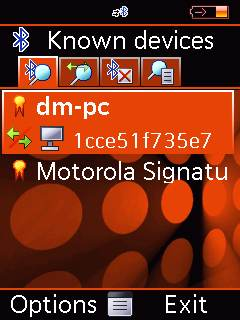
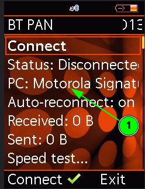
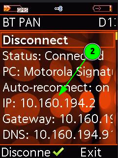

# Connecting the elf

[Русская версия](how-to-setup-elf.md)

Internet can be shared by a PC (running `sudo ./nap.sh`) or by an Android phone
with «Bluetooth tethering» turned on.

**1.** Make sure the phone is paired with the PC or Android phone: it must be listed in
Bluetooth → `Known devices`.

**2.** Start the elf. Select the `PC` row (1) and pick the paired PC or Android phone
from the list.

**3.** Select `Connect`. Once connected, the menu shows `Status: Connected` and the IP
address (2), and the top row turns into `Disconnect`. The browser, Java and elfs now go online through that device.

