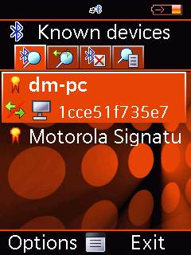
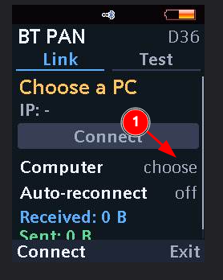
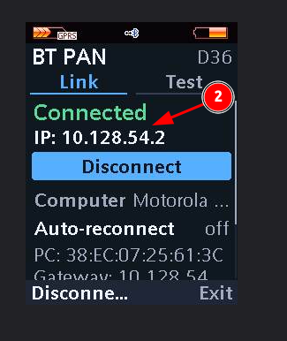

# Connecting the elf

[Русская версия](how-to-setup-elf.md)

Internet can be shared by a PC (running `sudo ./nap.sh`) or by an Android phone
with «Bluetooth tethering» turned on.

**1.** Make sure the phone is paired with the PC or Android phone: it must be listed in
Bluetooth → `Known devices`.

**2.** Start the elf. On the `Link` tab select the `Computer` row → `choose` and
pick the paired PC or Android phone from the list.

**3.** Press `Connect`. Once connected, a green `Connected` appears along with the IP
address. The browser, Java and elfs now go online through that device.

