# Настройка GPRS-профиля на телефоне

[English version](how-to-setup-gprs.en.md)

## 1. Создать точку доступа (NAP)

**1.1.** Открываем `Connectivity → Online settings`.

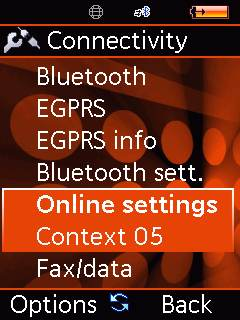

**1.2.** Выбираем любой свободный профиль (здесь — `Context 05`) и жмём
`Options → Edit`.

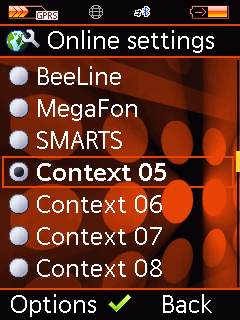

**1.3.** Переходим на последнюю вкладку — `NAP` — и жмём `Edit`.

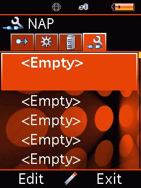

**1.4.** В списке выбираем `EGPRS`.

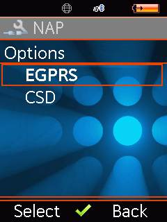

**1.5.** Вводим любое имя (`Name`) и любой `APN`. Логин и пароль можно оставить
пустыми. Сохраняем.

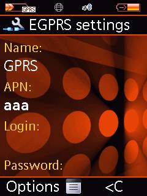

## 2. Привязать WAP-браузер

**2.1.** Переходим на вкладку `Applications`, выбираем `WAP browser` и жмём `Edit`.

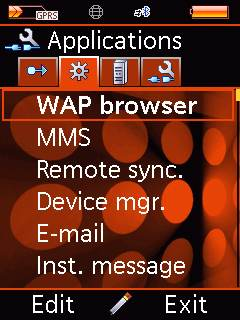

**2.2.** Выбираем `Profile one → Options → Edit`.

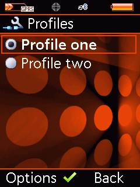

**2.3.** Вводим любое `Profile name` и открываем `Connect. list`.

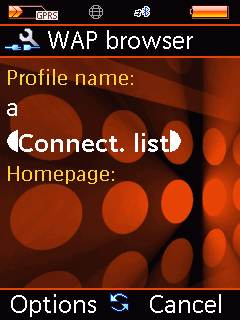

**2.4.** Список пустой — жмём `Options → Select conn.` и выбираем созданную ранее
точку доступа.

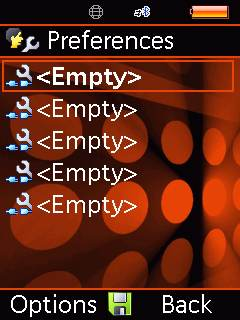
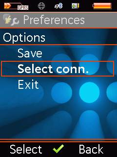

**2.5.** В списке появляется `01: GPRS` — наша точка доступа.

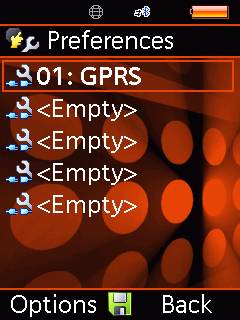

**2.6.** Обязательно сохраняем: `Options → Save`.

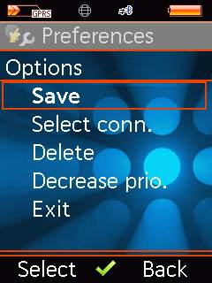

## 3. Привязать Java

**3.1.** На вкладке `Applications` выбираем `Java` и жмём `Edit`.

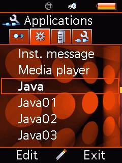

**3.2.** Так же вводим `Profile name` и открываем список подключений.

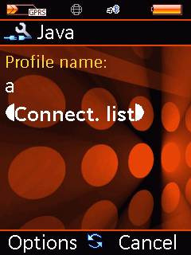

**3.3.** `Options → Select conn.`, выбираем ту же точку доступа и сохраняем.

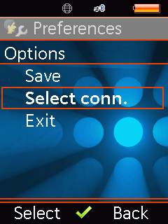

## 4. Если у Java-приложения нет интернета

**4.1.** В опциях самого приложения выбираем `Online settings`.

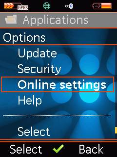

**4.2.** Редактируем `Gener. account` (`Edit`).

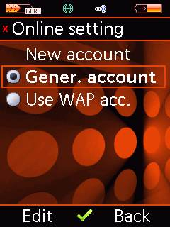

**4.3.** Вводим любое имя профиля, выбираем созданную ранее точку доступа и
сохраняем.

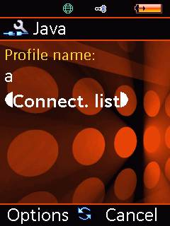
